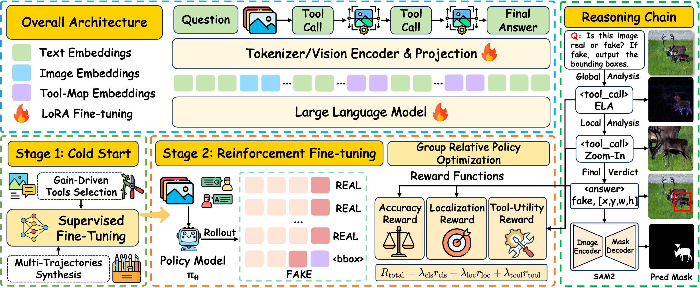
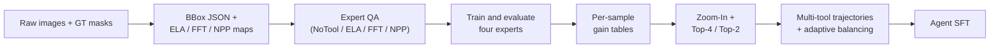

<div align="center">

# ForgeryVCR: Visual-Centric Reasoning via Efficient Forensic Tools in MLLMs for Image Forgery Detection and Localization

### 🎉 ACM Multimedia 2026 - $\color{red}{\text{Oral ＆ Outstanding Paper Award}}$

**Youqi Wang<sup>1,2&#42;†</sup> · Shen Chen<sup>2&#42;♠</sup> ·
Haowei Wang<sup>2</sup> · Rongxuan Peng<sup>1</sup> ·
Taiping Yao<sup>2</sup> · Shunquan Tan<sup>1✉</sup> ·
Changsheng Chen<sup>1</sup> · Bin Li<sup>1</sup> ·
Shouhong Ding<sup>2✉</sup>**

<sup>1</sup> Shenzhen University　　<sup>2</sup> Tencent Youtu Lab

<sup>&#42;</sup>Equal contribution.　<sup>♠</sup>Project Leader.　
<sup>✉</sup>Corresponding author.　<sup>†</sup>Work done during internship at Tencent Youtu Lab.

[](https://arxiv.org/abs/2602.14098)
[](https://youqiwong.github.io/projects/ForgeryVCR/)
[](https://huggingface.co/youqiwong/ForgeryVCR)
[](LICENSE)

**English** | [简体中文](README_CN.md)

[Model weights](https://huggingface.co/youqiwong/ForgeryVCR) ·
[Model and data](#3-model-and-data)

</div>

## 📰 News

### 🎉 ACM Multimedia 2026 - $\color{red}{\text{Oral ＆ Outstanding Paper Award}}$

- **[2026.11.16] 🚀 The SFT and RL (GRPO) training code is now publicly available, including dataset construction scripts and the multi-turn forensic-tool reward plugin.**
- **[2026.11.14] 🏆🏆🏆 ForgeryVCR has been awarded the ACM Multimedia 2026 Outstanding Paper Award!**
- **[2026.08.28] 🔥** The [arXiv paper](https://arxiv.org/abs/2602.14098), inference and evaluation code, and [online Demo](https://huggingface.co/spaces/youqiwong/ForgeryVCR-Demo) are now publicly available.
- **[2026.08.28] 🎉🎉🎉 ForgeryVCR has been accepted to ACM Multimedia 2026 as an Oral paper!**

> **Release status.** This release contains the full training pipeline (SFT and
> GRPO, including the multi-turn forensic-tool reward plugin and dataset
> preparation), the inference, forensic-map preparation, SAM2 mask generation,
> and evaluation pipeline.

ForgeryVCR turns a multimodal large language model into an active image
forensics agent. The agent can inspect an image with ELA, FFT, NPP, and Zoom-In
tools, classify it as authentic or tampered, and return tampered-region bounding
boxes. The predicted boxes can then prompt SAM2 for pixel-level masks.

## 1. Method overview

<p align="center">
  
</p>

The repository layout is:

```text
ForgeryVCR/
├── eval/                 # agent inference, SAM2 generation, and metrics
├── data/prepare/         # test manifest and forensic-map preparation
├── data/sft/             # SFT dataset construction utilities
├── data/rl/              # GRPO dataset construction utilities
├── experts/              # gain-driven tool selection (expert QA, gain tables, Zoom-In)
├── train/sft/            # SFT launcher
├── train/grpo/           # GRPO launcher and multi-turn reward plugin
├── tools/                # ELA, FFT, and NPP services
├── scripts/              # inference, evaluation, merge, and setup wrappers
├── docs/                 # data preparation, training, evaluation, deployment
├── requirements.txt      # core dependencies (inference, evaluation, SFT, GRPO)
└── ms-swift/             # pinned framework submodule
```

## 2. Installation

After cloning this repository, initialize the pinned `ms-swift` submodule from
the repository root:

```bash
git submodule update --init --recursive
```

Run all commands below from the repository root. The public workflow uses
repository-relative paths and does not require a separate path configuration
file.

Create the Python 3.12 environment:

```bash
conda create -n forgeryvcr python=3.12 -y
conda activate forgeryvcr
```

Before installing the repository requirements, install builds of
[PyTorch](https://pytorch.org/get-started/locally/) and FlashAttention that are
compatible with your accelerator, operating system, and Python environment.
Verify both packages first, then install the remaining dependencies:

```bash
python -c "import torch; print(torch.__version__)"
python -c "import flash_attn; print(flash_attn.__version__)"
python -m pip install -r requirements.txt
python -m pip install -e ./ms-swift
```

`requirements.txt` pins vLLM `0.23.0` together with the inference, evaluation,
SFT and GRPO dependencies. GRPO training uses `--attn_impl flash_attn`, so a
FlashAttention build matching your PyTorch version (validated with torch 2.11
and flash-attn 2.8.3.post2) has to be installed first.

Install SAM2 for pixel-level mask generation:

```bash
mkdir -p third_party
git clone https://github.com/facebookresearch/sam2.git third_party/sam2
SAM2_BUILD_CUDA=0 python -m pip install --no-build-isolation -e ./third_party/sam2

mkdir -p weights/sam2-hiera-large
curl -L \
  https://dl.fbaipublicfiles.com/segment_anything_2/072824/sam2_hiera_large.pt \
  -o weights/sam2-hiera-large/sam2_hiera_large.pt
```

## 3. Model and data

The released inference checkpoint is stored under `GRPO/`. Download it into the
path used by the scripts:

```bash
huggingface-cli download --resume-download youqiwong/ForgeryVCR \
  --repo-type model \
  --include "GRPO/*" \
  --local-dir weights/ForgeryVCR
```

SFT starts from Qwen3-VL-4B-Instruct. Download the base model into the path used
by the training launchers:

```bash
huggingface-cli download --resume-download Qwen/Qwen3-VL-4B-Instruct \
  --local-dir weights/Qwen3-VL-4B-Instruct
```

ForgeryVCR does **not** redistribute third-party datasets or their preprocessed
copies. Obtain the training and evaluation data from their maintainers and
follow the licence, access conditions and citation requirements of each
dataset. Section 4 documents the directory contract those files must follow.

## 4. Data Preparation

Sections 4–6 turn the source training data into forensic evidence, expert-ranked
tool policies, and the final Agent SFT dataset:



This repository does **not** redistribute any third-party dataset or its
preprocessed copy. Obtain every dataset, training and evaluation alike, from
its maintainers and follow the licence, access conditions and citation
requirements of that dataset.

After acquiring the original files, organize images and binary GT masks using
the contract below. `tp` denotes tampered samples and `au` denotes authentic
samples. SFT, GRPO, and evaluation use `train/832x`, `rl/832x`, and `test/832x`,
respectively:

```text
datasets/
├── train/832x/
│   ├── casia2_tp/{forged,gt,casia2_tp.txt,casia2_tp.json}
│   └── casia2_au/{images,casia2_au.txt}
├── rl/832x/
│   ├── imd20_tp/{forged,gt,imd20_tp.txt,imd20_tp.json}
│   ├── imd20_au/{images,imd20_au.txt}
│   ├── fr_tp/{forged,gt,fr_tp_filtered.txt,fr_tp.json}
│   └── fr_au/{images,fr_au.txt}
└── test/832x/
    ├── <benchmark>_tp/{forged,gt,<benchmark>_tp.txt,<benchmark>_tp.json}
    └── <benchmark>_au/{images,<benchmark>_au.txt}
```

`images/` is only a recommended name; paths in each authentic TXT must match
the actual relative location. A tampered TXT stores one image-mask pair per
line, while an authentic TXT stores one image path per line:

```text
forged/example.png,gt/example_gt.png
```

```text
images/example.png
```

Tampered-set JSON paths are relative to their dataset directories, for example
`forged/example.png` and `gt/example_gt.png`.

### Build BBox JSON

`data/prepare/mask_to_bbox.py` extracts boxes from GT masks in the same
coordinate system and can optionally resize both images and masks. Its default
noise-suppression settings are `--min_area_ratio 0.0005` and
`--open_ksize 3`.

If very small or thin connected regions are known to be valid manipulations and
must be retained, disable both area filtering and morphological opening. Using
the project's CASIA2 SFT dataset as an example:

```bash
python data/prepare/mask_to_bbox.py \
  --txt datasets/train/832x/casia2_tp/casia2_tp.txt \
  --base_dir datasets/train/832x/casia2_tp \
  --out datasets/train/832x/casia2_tp/casia2_tp.json \
  --min_area_ratio 0.0 \
  --open_ksize 0
```

The generated `datasets/train/832x/casia2_tp/casia2_tp.json` is a list of
samples. Each record stores the relative forged-image path, relative GT-mask
path, and one or more pixel-coordinate boxes:

```json
[
  {
    "forged_path": "forged/Tp_D_CND_M_N_ani00018_sec00096_00138.png",
    "mask_path": "gt/Tp_D_CND_M_N_ani00018_sec00096_00138_gt.png",
    "bboxes": [
      [214, 176, 503, 598],
      [612, 241, 701, 336]
    ]
  }
]
```

Each box follows `[x1, y1, x2, y2]`. If no valid box survives filtering, the
sample is omitted from the final JSON. Paths are relative to the directory
containing `casia2_tp.json` and can be consumed directly by expert dataset
construction, SFT trajectory generation, and GRPO dataset generation.

If the input has not yet been converted to the training resolution, add
`--target_size 832` to the command.

### Forensic tool maps

Start the ELA, FFT, and NPP services in one terminal:

```bash
bash tools/start.sh
```

Generate cached tool maps in another terminal:

```bash
python data/prepare/generate_tool_maps.py \
  --base_dir datasets/test/832x \
  --datasets \
    casia1_tp casia1_au \
    columbia_tp columbia_au \
    coverage_tp coverage_au \
    dso_tp dso_au \
    glide_tp glide_au \
    korus_tp korus_au \
    in_the_wild_tp \
    NIST16_tp NIST16_au \
    SID_Set_tp SID_Set_au \
  --out_root datasets/test/832x/tool_maps \
  --workers 64
```

The generator is resumable and skips existing maps. Generate the training maps
with:

```bash
python data/prepare/generate_tool_maps.py \
  --base_dir datasets/train/832x \
  --datasets casia2_tp casia2_au \
  --out_root datasets/train/tool_maps \
  --workers 64
```

Check required files and Python dependencies before running a stage:

```bash
python scripts/check_setup.py
```

## 5. Expert Training and Tool Selection

Workflow: ① train experts → ② evaluate experts → ③ build gain tables →
④ add Zoom-In.

### 5.1 Train lightweight experts

Four lightweight experts provide the evidence used to construct the SFT
trajectories:

- **NoTool:** original image only.
- **ELA:** compression inconsistencies.
- **FFT:** frequency-domain artifacts.
- **NPP:** noise-fingerprint inconsistencies.

Build each balanced expert QA set with `experts/build_qa_dataset.py`. For
example, the ELA expert dataset is generated with:

```bash
python experts/build_qa_dataset.py \
  --tool ela \
  --fake_json datasets/train/832x/casia2_tp/casia2_tp.json \
  --au_dir datasets/train/832x/casia2_au \
  --toolmap_dir datasets/train/tool_maps \
  --out workdir/results/qa_ela.json \
  --balance --seed 42
```

Repeat with `notool`, `fft`, and `npp` and the corresponding output names;
`notool` does not require `--toolmap_dir`. Then train with:

```bash
bash experts/train/sft_notool.sh
bash experts/train/sft_ela.sh
bash experts/train/sft_fft.sh
bash experts/train/sft_npp.sh
```

### 5.2 Evaluate the expert models

Run each merged expert on the complete balanced CASIA v2 QA set:

```bash
bash experts/test/run_expert_test.sh notool path/to/notool/checkpoint
bash experts/test/run_expert_test.sh ela path/to/ela/checkpoint
bash experts/test/run_expert_test.sh fft path/to/fft/checkpoint
bash experts/test/run_expert_test.sh npp path/to/npp/checkpoint
```

### 5.3 Build per-sample gain tables

```bash
python experts/compute_gain_csv.py \
  --gt_json datasets/train/832x/casia2_tp/casia2_tp.json \
  --tool NoTool=workdir/results/notool.jsonl \
  --tool ELA=workdir/results/ela.jsonl \
  --tool FFT=workdir/results/fft.jsonl \
  --tool NPP=workdir/results/npp.jsonl \
  --prob NoTool=workdir/results/scores_notool.jsonl \
  --prob ELA=workdir/results/scores_ela.jsonl \
  --prob FFT=workdir/results/scores_fft.jsonl \
  --prob NPP=workdir/results/scores_npp.jsonl \
  --out_tp workdir/results/casia2_tp_analysis_threshold.csv \
  --out_au workdir/results/casia2_au_analysis_threshold.csv \
  --top_fake 4 \
  --top_real 2 \
  --iou_threshold 0.5 \
  --real_prob_threshold 0.5 \
  --img_size 832 \
  --coord_max 1000
```

For tampered samples, a tool must classify correctly, reach Hungarian mean
BBox-IoU above 0.5, and improve over NoTool. For authentic samples, a tool must
classify correctly and have normalized `P(real) > 0.5`. Qualified tools are
ranked by IoU or `P(real)` and truncated to Top-4 or Top-2. Samples for which
all strategies fail are removed by Intractable Sample Removal.

### 5.4 Add the Zoom-In policy

After filtering and ranking NoTool, ELA, FFT, and NPP, add Zoom-In according
to the region rule: small GT regions for tampered images and salient regions
for authentic images.
These thresholds are empirical. They restrict Zoom-In to cases where local
evidence is useful and, in particular, prevent excessive Zoom-In calls on
authentic samples. Retune them when transferring to a different distribution.

```bash
# --tp_csv: input tampered-sample gain table
# --bbox_json: input tampered-sample GT boxes
# --out_csv: output gain table with Zoom-In decisions
# --crop_dir: directory for Zoom-In crops
# --max_area_ratio: trigger below 5% tampered-area ratio (empirical threshold)
# --max_tools: retain at most four callable tools; Zoom-In is last and NoTool is excluded
# --img_size: output BBox coordinate-system size
python experts/add_zoomin_by_area.py \
  --tp_csv workdir/results/casia2_tp_analysis_threshold.csv \
  --bbox_json datasets/train/832x/casia2_tp/casia2_tp.json \
  --out_csv workdir/results/casia2_tp_analysis_threshold_zoomin_top4.csv \
  --crop_dir workdir/zoomin_images/tampered \
  --max_area_ratio 0.05 \
  --max_tools 4 \
  --img_size 832

# --au_csv: input authentic-sample gain table
# --out_csv: output gain table with Zoom-In decisions
# --crop_dir: directory for Zoom-In crops
# --score_threshold: trigger at saliency concentration >= 0.35 (empirical threshold)
# --top_fraction: score using the strongest 10% of saliency pixels (empirical ratio)
# --saliency_percentile: extract candidates above the 90th percentile (empirical threshold)
# --min_crop_ratio: crop width and height are at least 15% of the image (empirical ratio)
# --max_tools: retain at most two callable tools; Zoom-In is last and NoTool is excluded
# --img_size: output BBox coordinate-system size
python experts/add_real_zoomin_by_saliency.py \
  --au_csv workdir/results/casia2_au_analysis_threshold.csv \
  --out_csv workdir/results/casia2_au_analysis_threshold_zoomin_top2.csv \
  --crop_dir workdir/zoomin_images/authentic \
  --score_threshold 0.35 \
  --top_fraction 0.10 \
  --saliency_percentile 90 \
  --min_crop_ratio 0.15 \
  --max_tools 2 \
  --img_size 832
```

## 6. Agent SFT

Given a gain-ranked list `T1, T2, ...`, Multi-Trajectory Synthesis creates
NoTool, valid single-tool trajectories, and cumulative ordered prefixes such
as `T1 → T2` and `T1 → T2 → T3`. It does not create arbitrary permutations or
repeat a tool.

Generate and balance the Top-4/Top-2 SFT dataset:

```bash
python data/sft/generate_SFT_datasets.py \
  --real_csv workdir/results/casia2_au_analysis_threshold_zoomin_top2.csv \
  --fake_csv workdir/results/casia2_tp_analysis_threshold_zoomin_top4.csv \
  --fake_json datasets/train/832x/casia2_tp/casia2_tp.json \
  --toolmap_root datasets/train/tool_maps \
  --zoom_save_dir workdir/zoomin_images/generated_fallback \
  --output_json data/sft/sft_dataset_top4_top2.json \
  --real_k 2 \
  --fake_k 4 \
  --seed 42

python data/sft/balance_sft_dataset.py \
  --input_json data/sft/sft_dataset_top4_top2.json \
  --output_json data/sft/sft_dataset_top4_top2_balanced.json \
  --multi_tool_min 2 \
  --seed 42
```

Balancing downsamples only the majority label. Multi-tool trajectories are
retained before sampling NoTool and single-tool strata.

Train the agent for six epochs:

```bash
MODEL_PATH=weights/Qwen3-VL-4B-Instruct \
SFT_DATASET_PATH=data/sft/sft_dataset_top4_top2_balanced.json \
SFT_NUM_TRAIN_EPOCHS=6 \
SFT_REPORT_TO=wandb \
bash train/sft/sft_forgeryvcr_top4_top2.sh
```

Merge the selected SFT checkpoint before GRPO:

```bash
bash scripts/merge_lora.sh train/sft/outputs/checkpoint-N
```

## 7. GRPO Training

Build the repository-local IMD2020 and FantasticReality prompt files:

```bash
python data/rl/generate_RL_datasets.py \
  --data_root datasets/rl/832x \
  --output_dir data/rl/datasets \
  --fr_sample_limit 5000 \
  --seed 42
```

Generate the IMD2020 and FantasticReality tool maps used during rollout:

```bash
python data/prepare/generate_tool_maps.py \
  --base_dir datasets/rl/832x \
  --datasets imd20_tp imd20_au fr_tp fr_au \
  --out_root datasets/train/tool_maps \
  --workers 64
```

Launch the paper configuration from a merged SFT model:

```bash
GRPO_MODEL_PATH=train/sft/outputs/checkpoint-N-merged \
GRPO_TOOL_MAP_ROOT=datasets/train/tool_maps \
GRPO_GENERATION_BATCH_SIZE=256 \
GRPO_VLLM_MAX_NUM_SEQS=256 \
GRPO_VLLM_MM_PROCESSOR_CACHE_GB=4 \
WANDB_PROJECT=ForgeryVCR \
bash train/grpo/grpo.sh
```

The launcher uses eight GPUs, LoRA rank/alpha 128/256, eight generations,
two epochs, learning rate `5e-5`, and the composite reward:

```text
R = 1.0 × R_classification + 2.0 × R_localization + 0.5 × R_tool-utility
```

The released inference checkpoint (`GRPO/`, see Section 3) can be evaluated
directly with Section 8; training starts from the merged SFT checkpoint above.

## 8. Inference and evaluation

Run the full visual agent and generate SAM2 masks:

```bash
INFERENCE_MODEL_PATH=weights/ForgeryVCR/GRPO \
INFERENCE_DATASETS="all" \
INFERENCE_EXP_NAME=forgeryvcr_grpo \
INFERENCE_SEED=42 \
bash scripts/run_inference.sh
```

The script uses the accelerator devices exposed by the current execution
environment. To evaluate only a subset, set a space-separated list such as
`INFERENCE_DATASETS="casia1_tp casia1_au"`. Set `INFERENCE_USE_SAM2=0` to skip
pixel-mask generation. ELA, FFT, and NPP are loaded from the cached maps created
in Section 4, so the forensic services can be stopped after map generation.
Zoom-In crops are produced dynamically during agent inference.

Aggregate image-level classification, BBox-IoU, Pixel-IoU, and Pixel-F1:

```bash
INFERENCE_EXP_NAME=forgeryvcr_grpo \
bash scripts/run_eval.sh
```

If the prediction-mask directory does not exist, classification and BBox-IoU
are still evaluated, while Pixel-F1 and Pixel-IoU are left blank. Missing GT
masks are reported explicitly and counted instead of being skipped silently.

Predictions, masks, and the final report are written under
`inference_outputs/forgeryvcr_grpo/`:

```text
inference_outputs/forgeryvcr_grpo/
├── <dataset>.json                 # full multi-turn dialogue per sample
├── pred_masks/<dataset>/*.png     # SAM2 masks for predicted fake samples
└── eval_reports/eval_metrics.tsv  # aggregated evaluation report
```

Each result JSON preserves `images`, `dataset`, `is_tampered`, and
`bbox_objects`, and adds the complete `messages` trajectory. Assistant messages
contain either `<tool_call>...</tool_call>` or the final
`<answer>real|fake, ...</answer>`; tool responses record the selected tool,
arguments, returned visual evidence, and turn index. Runtime result paths may be
resolved to local absolute paths, while all distributed dataset manifests and
tool-map indices remain repository-portable.

A shortened tampered-sample result has the following structure:

```json
{
  "images": ["<resolved-image-path>"],
  "dataset": "casia1_tp",
  "is_tampered": true,
  "bbox_objects": {"bbox": [[214, 176, 503, 598]]},
  "messages": [
    {"role": "user", "content": "Is this image real or fake? ..."},
    {"role": "assistant", "content": "<tool_call>...ELA...</tool_call>", "turn": 1},
    {"role": "tool_response", "tool_name": "ELA", "image_info": "<resolved-map-path>", "turn": 1},
    {"role": "assistant", "content": "<answer>fake, ...</answer>", "turn": 2}
  ]
}
```

## 9. Citation and license

```bibtex
@inproceedings{wang2026forgeryvcr,
  title     = {ForgeryVCR: Visual-Centric Reasoning via Efficient Forensic Tools
               in MLLMs for Image Forgery Detection and Localization},
  author    = {Wang, Youqi and Chen, Shen and Wang, Haowei and Peng, Rongxuan
               and Yao, Taiping and Tan, Shunquan and Chen, Changsheng
               and Li, Bin and Ding, Shouhong},
  booktitle = {Proceedings of the 34th ACM International Conference on Multimedia},
  year      = {2026}
}
```

ForgeryVCR builds on
[ms-swift](https://github.com/modelscope/ms-swift),
[Qwen3-VL](https://github.com/QwenLM/Qwen3-VL), and
[SAM2](https://github.com/facebookresearch/sam2).

Original code in this repository is released under the
[Apache License 2.0](LICENSE). Datasets, model weights, and third-party
components remain subject to their respective licenses and terms. In
particular, the bundled NPP backend is governed by its
[upstream license](tools/backends/npp/LICENSE.txt), which restricts its use
to informational and nonprofit purposes.
