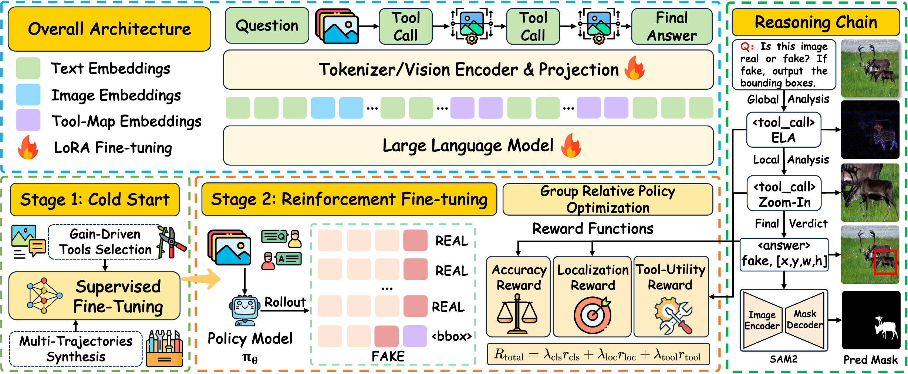
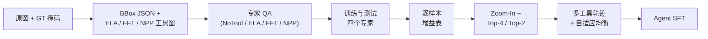

<div align="center">

# ForgeryVCR: Visual-Centric Reasoning via Efficient Forensic Tools in MLLMs for Image Forgery Detection and Localization

### 🎉 ACM Multimedia 2026 - $\color{red}{\text{Oral ＆ Outstanding Paper Award}}$

**Youqi Wang<sup>1,2&#42;†</sup> · Shen Chen<sup>2&#42;♠</sup> ·
Haowei Wang<sup>2</sup> · Rongxuan Peng<sup>1</sup> ·
Taiping Yao<sup>2</sup> · Shunquan Tan<sup>1✉</sup> ·
Changsheng Chen<sup>1</sup> · Bin Li<sup>1</sup> ·
Shouhong Ding<sup>2✉</sup>**

<sup>1</sup> 深圳大学　　<sup>2</sup> 腾讯优图实验室

<sup>&#42;</sup>共同一作。　<sup>♠</sup>项目负责人。　
<sup>✉</sup>通讯作者。　<sup>†</sup>相关工作于腾讯优图实习期间完成。

[](https://arxiv.org/abs/2602.14098)
[](https://youqiwong.github.io/projects/ForgeryVCR/)
[](https://huggingface.co/youqiwong/ForgeryVCR)
[](LICENSE)

[English](README.md) | **简体中文**

[模型权重](https://huggingface.co/youqiwong/ForgeryVCR) ·
[模型与数据](#3-模型与数据)

</div>

## 📰 最新动态

### 🎉 ACM Multimedia 2026 - $\color{red}{\text{Oral ＆ Outstanding Paper Award}}$

- **[2026.11.16] 🚀 SFT 与 RL（GRPO）阶段训练代码现已公开，含数据构建脚本与多轮取证工具奖励插件。**
- **[2026.11.14] 🏆🏆🏆 ForgeryVCR 荣获 ACM Multimedia 2026 杰出论文奖！**
- **[2026.08.28] 🔥** [arXiv 论文](https://arxiv.org/abs/2602.14098)、推理与评估代码以及[在线 Demo](https://huggingface.co/spaces/youqiwong/ForgeryVCR-Demo)现已公开。
- **[2026.08.28] 🎉🎉🎉 ForgeryVCR 被 ACM Multimedia 2026 接收为 Oral 论文！**

> **发布状态：**本版本提供完整训练流程（SFT 与 GRPO，含多轮取证工具奖励插件与数据集
> 准备）、推理、取证工具图准备、SAM2 掩码生成和评估流程。

ForgeryVCR 将多模态大语言模型转化为主动式图像取证智能体。智能体可调用 ELA、
FFT、NPP 和 Zoom-In 工具分析图像，判断图像真实或篡改并输出篡改区域边界框，随后
可将预测框作为视觉提示交给 SAM2，得到像素级掩码。

## 1. 方法概览

<p align="center">
  
</p>

仓库主要目录如下：

```text
ForgeryVCR/
├── eval/                 # 智能体推理、SAM2 掩码与指标计算
├── data/prepare/         # 测试清单与取证工具图准备
├── data/sft/             # SFT 数据集构建工具
├── data/rl/              # GRPO 数据集构建工具
├── experts/              # 增益驱动的工具选择（专家 QA、增益表、Zoom-In）
├── train/sft/            # SFT 启动脚本
├── train/grpo/           # GRPO 启动脚本与多轮奖励插件
├── tools/                # ELA、FFT、NPP 服务
├── scripts/              # 推理、评估、权重合并与环境检查脚本
├── docs/                 # 数据准备、训练、评估与部署说明
├── requirements.txt      # 核心依赖（推理、评估、SFT、GRPO）
└── ms-swift/             # 固定版本的框架子模块
```

## 2. 环境安装

克隆本仓库后，在项目根目录初始化固定版本的 `ms-swift` 子模块：

```bash
git submodule update --init --recursive
```

下文命令均在项目根目录下执行。公开流程统一使用项目相对路径，不需要额外的路径配置文件。

创建 Python 3.12 环境：

```bash
conda create -n forgeryvcr python=3.12 -y
conda activate forgeryvcr
```

安装仓库依赖前，必须先安装与当前加速器、操作系统和 Python 环境兼容的
[PyTorch](https://pytorch.org/get-started/locally/) 与 FlashAttention。确认二者可正常导入后，
再安装其余依赖：

```bash
python -c "import torch; print(torch.__version__)"
python -c "import flash_attn; print(flash_attn.__version__)"
python -m pip install -r requirements.txt
python -m pip install -e ./ms-swift
```

`requirements.txt` 固定 vLLM `0.23.0` 以及推理、评估、SFT 与 GRPO 依赖。
GRPO 训练使用 `--attn_impl flash_attn`，因此需要先安装与当前 PyTorch 匹配的
FlashAttention（已在 torch 2.11 + flash-attn 2.8.3.post2 下验证）。

安装像素级掩码生成所需的 SAM2：

```bash
mkdir -p third_party
git clone https://github.com/facebookresearch/sam2.git third_party/sam2
SAM2_BUILD_CUDA=0 python -m pip install --no-build-isolation -e ./third_party/sam2

mkdir -p weights/sam2-hiera-large
curl -L \
  https://dl.fbaipublicfiles.com/segment_anything_2/072824/sam2_hiera_large.pt \
  -o weights/sam2-hiera-large/sam2_hiera_large.pt
```

## 3. 模型与数据

发布的推理权重保存在模型仓库的 `GRPO/` 目录下，下载命令如下：

```bash
huggingface-cli download --resume-download youqiwong/ForgeryVCR \
  --repo-type model \
  --include "GRPO/*" \
  --local-dir weights/ForgeryVCR
```

SFT 从 Qwen3-VL-4B-Instruct 开始，先把底座模型下载到训练脚本使用的路径：

```bash
huggingface-cli download --resume-download Qwen/Qwen3-VL-4B-Instruct \
  --local-dir weights/Qwen3-VL-4B-Instruct
```

ForgeryVCR **不重新分发第三方数据集或其预处理副本**。训练与评估数据均需从各数据集
维护方获取，并遵守各自的许可、访问条件与引用要求。这些文件需要遵循的目录结构见第
4 节。

## 4. 数据准备

第 4～6 节从原始训练数据出发，依次完成工具证据准备、专家筛选和 Agent SFT：



本仓库**不重新分发任何第三方数据集或其预处理副本**。训练与评估用的数据集
均需从各数据集维护方获取，并遵守各自的许可、访问条件与引用要求。

获取原始文件后，将图像和二值 GT 掩码整理为以下统一结构。`tp` 表示篡改样本，
`au` 表示真实样本；SFT、GRPO 和测试阶段分别使用 `train/832x`、`rl/832x` 和
`test/832x`：

```text
datasets/
├── train/832x/
│   ├── casia2_tp/{forged,gt,casia2_tp.txt,casia2_tp.json}
│   └── casia2_au/{images,casia2_au.txt}
├── rl/832x/
│   ├── imd20_tp/{forged,gt,imd20_tp.txt,imd20_tp.json}
│   ├── imd20_au/{images,imd20_au.txt}
│   ├── fr_tp/{forged,gt,fr_tp_filtered.txt,fr_tp.json}
│   └── fr_au/{images,fr_au.txt}
└── test/832x/
    ├── <benchmark>_tp/{forged,gt,<benchmark>_tp.txt,<benchmark>_tp.json}
    └── <benchmark>_au/{images,<benchmark>_au.txt}
```

`images/` 只是推荐目录名；真实集 TXT 中的相对路径与实际位置一致即可。篡改集 TXT
每行写一对相对路径，真实集 TXT 每行写一个相对图像路径：

```text
forged/example.png,gt/example_gt.png
```

```text
images/example.png
```

例如 `datasets/test/832x/casia1_tp/casia1_tp.json` 中的一条篡改样本为：

```json
{
  "forged_path": "forged/Sp_D_NNN_A_sec0002_ani0001_0282.png",
  "mask_path": "gt/Sp_D_NNN_A_sec0002_ani0001_0282_gt.png",
  "bboxes": [[214, 176, 503, 598]]
}
```

路径相对于当前 JSON 所在的数据集目录；`bboxes` 使用 832×832 像素坐标，
每个框为 `[x1, y1, x2, y2]`。真实集没有 GT BBox JSON，其 TXT 示例为：

```text
Au_ani_00001.png
Au_ani_00002.png
```

### 生成 BBox JSON

`data/prepare/mask_to_bbox.py` 根据 GT 掩码生成同一坐标系下的 BBox JSON，
也可选择同时转换原图和掩码的分辨率。默认噪声抑制参数为
`--min_area_ratio 0.0005` 和 `--open_ksize 3`。

如果确认非常小或很细的连通区域属于有效篡改、需要完整保留，可以将面积过滤和
形态学开运算都关闭。以项目的 CASIA2 SFT 训练集为例：

```bash
python data/prepare/mask_to_bbox.py \
  --txt datasets/train/832x/casia2_tp/casia2_tp.txt \
  --base_dir datasets/train/832x/casia2_tp \
  --out datasets/train/832x/casia2_tp/casia2_tp.json \
  --min_area_ratio 0.0 \
  --open_ksize 0
```

生成的 `datasets/train/832x/casia2_tp/casia2_tp.json` 是一个样本列表，
其中每条记录包含篡改图像相对路径、GT 掩码相对路径以及一个或多个像素坐标 BBox：

```json
[
  {
    "forged_path": "forged/Tp_D_CND_M_N_ani00018_sec00096_00138.png",
    "mask_path": "gt/Tp_D_CND_M_N_ani00018_sec00096_00138_gt.png",
    "bboxes": [
      [214, 176, 503, 598],
      [612, 241, 701, 336]
    ]
  }
]
```

每个 BBox 均为 `[x1, y1, x2, y2]`；如果过滤后没有任何有效 BBox，该样本不会
写入最终 JSON。路径相对于 `casia2_tp.json` 所在目录，可直接供专家数据构建、SFT
轨迹生成和 GRPO 数据生成脚本读取。

如果输入数据尚未转换到训练分辨率，在命令中增加 `--target_size 832`。

### 生成取证工具图

在一个终端中启动 ELA、FFT 和 NPP 服务：

```bash
bash tools/start.sh
```

在另一个终端中生成并缓存工具图：

```bash
python data/prepare/generate_tool_maps.py \
  --base_dir datasets/test/832x \
  --datasets \
    casia1_tp casia1_au \
    columbia_tp columbia_au \
    coverage_tp coverage_au \
    dso_tp dso_au \
    glide_tp glide_au \
    korus_tp korus_au \
    in_the_wild_tp \
    NIST16_tp NIST16_au \
    SID_Set_tp SID_Set_au \
  --out_root datasets/test/832x/tool_maps \
  --workers 64
```

生成脚本支持断点续跑，并会跳过已经存在的工具图。训练集工具图生成命令如下：

```bash
python data/prepare/generate_tool_maps.py \
  --base_dir datasets/train/832x \
  --datasets casia2_tp casia2_au \
  --out_root datasets/train/tool_maps \
  --workers 64
```

工具图按“数据集/工具”分目录保存，避免不同数据集出现同名图像时互相覆盖：

```text
datasets/train/tool_maps/
├── casia2_tp/
│   ├── ELA/<stem>_ELA.png
│   ├── FFT/<stem>_FFT.png
│   └── NPP/<stem>_NPP.png
└── casia2_au/
    ├── ELA/<stem>_ELA.png
    ├── FFT/<stem>_FFT.png
    └── NPP/<stem>_NPP.png
```

准备完成后可检查公开流程所需的文件与 Python 依赖：

```bash
python scripts/check_setup.py
```

## 5. 专家训练与工具选择

流程顺序：① 训练专家 → ② 测试专家 → ③ 生成工具增益表 → ④ 加入 Zoom-In。

### 5.1 训练轻量级专家

四个轻量级专家为 SFT 轨迹构造提供逐样本证据：

- **NoTool：** 仅使用原始图像。
- **ELA：** 分析压缩不一致性。
- **FFT：** 分析频域伪影。
- **NPP：** 分析噪声指纹不一致性。

先使用 `experts/build_qa_dataset.py` 构建四份真实/篡改 1:1 的专家 QA 数据。
`--toolmap_dir` 指向上一节生成的工具图根目录；脚本会根据样本路径自动进入
`casia2_tp/<工具>` 或 `casia2_au/<工具>`：

```bash
python experts/build_qa_dataset.py \
  --tool notool \
  --fake_json datasets/train/832x/casia2_tp/casia2_tp.json \
  --au_dir datasets/train/832x/casia2_au \
  --out workdir/results/qa_notool.json \
  --balance --seed 42

python experts/build_qa_dataset.py \
  --tool ela \
  --fake_json datasets/train/832x/casia2_tp/casia2_tp.json \
  --au_dir datasets/train/832x/casia2_au \
  --toolmap_dir datasets/train/tool_maps \
  --out workdir/results/qa_ela.json \
  --balance --seed 42

python experts/build_qa_dataset.py \
  --tool fft \
  --fake_json datasets/train/832x/casia2_tp/casia2_tp.json \
  --au_dir datasets/train/832x/casia2_au \
  --toolmap_dir datasets/train/tool_maps \
  --out workdir/results/qa_fft.json \
  --balance --seed 42

python experts/build_qa_dataset.py \
  --tool npp \
  --fake_json datasets/train/832x/casia2_tp/casia2_tp.json \
  --au_dir datasets/train/832x/casia2_au \
  --toolmap_dir datasets/train/tool_maps \
  --out workdir/results/qa_npp.json \
  --balance --seed 42
```

以 ELA 专家为例，生成 JSON 是一个样本数组。篡改样本包含原图、ELA 图、类别标签和
GT BBox：

```json
{
  "messages": [
    {"role": "user", "content": "<image><image>The first image is the original input, and the second is its ELA heatmap. ..."},
    {"role": "assistant", "content": "<answer>fake, <bbox></answer>"}
  ],
  "images": [
    "datasets/train/832x/casia2_tp/forged/example.png",
    "datasets/train/tool_maps/casia2_tp/ELA/example_ELA.png"
  ],
  "label": 1,
  "objects": {"bbox": [[214, 176, 503, 598]]}
}
```

真实样本同样提供原图和对应工具图，但答案为 `real`，且不含 `objects`：

```json
{
  "messages": [
    {"role": "user", "content": "<image><image>The first image is the original input, and the second is its ELA heatmap. ..."},
    {"role": "assistant", "content": "<answer>real</answer>"}
  ],
  "images": [
    "datasets/train/832x/casia2_au/example.png",
    "datasets/train/tool_maps/casia2_au/ELA/example_ELA.png"
  ],
  "label": 0
}
```

NoTool QA 的 `images` 只有原图；FFT/NPP QA 的第二张图分别换为对应工具图。
QA 准备完成后训练四个专家：

```bash
bash experts/train/sft_notool.sh
bash experts/train/sft_ela.sh
bash experts/train/sft_fft.sh
bash experts/train/sft_npp.sh
```

### 5.2 测试专家模型

在完整且均衡的 CASIA v2 QA 数据上测试合并后的专家：

```bash
bash experts/test/run_expert_test.sh notool path/to/notool/checkpoint
bash experts/test/run_expert_test.sh ela path/to/ela/checkpoint
bash experts/test/run_expert_test.sh fft path/to/fft/checkpoint
bash experts/test/run_expert_test.sh npp path/to/npp/checkpoint
```

上述命令生成 `workdir/results/{notool,ela,fft,npp}.jsonl`。真实样本还需要在
`<answer>` 后读取 `real`/`fake` token 的归一化概率：

```bash
torchrun --nproc_per_node=8 experts/inference_realtoken.py \
  --tool_name NoTool \
  --model path/to/notool/checkpoint-merged \
  --data workdir/results/qa_notool.json \
  --output workdir/results/scores_notool.jsonl

torchrun --nproc_per_node=8 experts/inference_realtoken.py \
  --tool_name ELA \
  --model path/to/ela/checkpoint-merged \
  --data workdir/results/qa_ela.json \
  --output workdir/results/scores_ela.jsonl

torchrun --nproc_per_node=8 experts/inference_realtoken.py \
  --tool_name FFT \
  --model path/to/fft/checkpoint-merged \
  --data workdir/results/qa_fft.json \
  --output workdir/results/scores_fft.jsonl

torchrun --nproc_per_node=8 experts/inference_realtoken.py \
  --tool_name NPP \
  --model path/to/npp/checkpoint-merged \
  --data workdir/results/qa_npp.json \
  --output workdir/results/scores_npp.jsonl
```

每行概率结果记录原图路径、工具名、真假标签、`real_prob_raw`、
`fake_prob_raw` 与 `normalized_real_prob`，下一步会将它与 vLLM 分类/定位结果按原图合并。

### 5.3 生成逐样本工具增益表

```bash
python experts/compute_gain_csv.py \
  --gt_json datasets/train/832x/casia2_tp/casia2_tp.json \
  --tool NoTool=workdir/results/notool.jsonl \
  --tool ELA=workdir/results/ela.jsonl \
  --tool FFT=workdir/results/fft.jsonl \
  --tool NPP=workdir/results/npp.jsonl \
  --prob NoTool=workdir/results/scores_notool.jsonl \
  --prob ELA=workdir/results/scores_ela.jsonl \
  --prob FFT=workdir/results/scores_fft.jsonl \
  --prob NPP=workdir/results/scores_npp.jsonl \
  --out_tp workdir/results/casia2_tp_analysis_threshold.csv \
  --out_au workdir/results/casia2_au_analysis_threshold.csv \
  --top_fake 4 \
  --top_real 2 \
  --iou_threshold 0.5 \
  --real_prob_threshold 0.5 \
  --img_size 832 \
  --coord_max 1000
```

对于篡改样本，工具必须分类正确、匈牙利匹配平均 BBox-IoU 大于 0.5，
并且定位 IoU 高于 NoTool。对于真实样本，工具必须分类正确且归一化
`P(real) > 0.5`。满足条件的工具分别按照 IoU 或 `P(real)` 排序，
并截取篡改 Top-4、真实 Top-2。如果所有策略均失败，则通过
Intractable Sample Removal 将该样本剔除。

脚本分别输出篡改 CSV 与真实 CSV，每行对应一张图像，主要字段为：

| 字段 | 含义 |
|---|---|
| `Image Path`, `GT Label` | 原图路径和真值类别（0=真实，1=篡改） |
| `<Tool>_Pred_Label` | NoTool/ELA/FFT/NPP 的预测类别 |
| `<Tool>_Cls_Correct` | 该策略是否分类正确 |
| `<Tool>_BBox_IoU` | 篡改样本的平均匈牙利匹配 BBox-IoU；未匹配框按 0 计 |
| `<Tool>_Real_Prob` | 真实样本上归一化后的 `P(real)` |
| `<Tool>_Selected`, `<Tool>_Selection_Rank` | 是否入选及其一基排序 |
| `Effective_Tools_List` | 经过阈值、增益与 Top-K 筛选后的有序工具列表 |
| `Num_Selected_Tools`, `Is_HardSample` | 有效工具数和是否被 ISR 判为困难样本 |

以下是保留核心列后的两行示意；实际 CSV 会为每个策略保留上表中的完整诊断列：

```csv
Image Path,GT Label,ELA_Cls_Correct,ELA_BBox_IoU,ELA_Real_Prob,Effective_Tools_List,Num_Selected_Tools,Is_HardSample
datasets/train/832x/casia2_tp/forged/example.png,1,1,0.8074,,"ELA,FFT,NPP",3,0
datasets/train/832x/casia2_au/example.png,0,1,,0.9810,"FFT,ELA",2,0
```

### 5.4 加入 Zoom-In 策略

完成 NoTool、ELA、FFT 和 NPP 的筛选与排序后，再根据区域规则加入 Zoom-In：
篡改图像使用小型 GT 区域，真实图像使用显著区域。
以下阈值为经验性设置，目的是仅在局部证据确有必要时调用 Zoom-In，尤其避免真实
样本产生过多 Zoom-In 调用；迁移到不同数据分布时可重新调整。

```bash
# 为篡改样本加入 Zoom-In：小型 GT 区域触发，裁剪框由 GT BBox 确定性扰动得到
# --tp_csv：输入篡改样本增益表
# --bbox_json：输入篡改样本 GT BBox
# --out_csv：输出加入 Zoom-In 决策后的增益表
# --crop_dir：保存 Zoom-In 裁剪图
# --max_area_ratio：篡改区域占比低于 5% 时触发 Zoom-In（经验阈值）
# --max_tools：最多保留 4 个可调用工具，Zoom-In 位于末尾，NoTool 不计入上限
# --img_size：BBox 输出坐标系大小
python experts/add_zoomin_by_area.py \
  --tp_csv workdir/results/casia2_tp_analysis_threshold.csv \
  --bbox_json datasets/train/832x/casia2_tp/casia2_tp.json \
  --out_csv workdir/results/casia2_tp_analysis_threshold_zoomin_top4.csv \
  --crop_dir workdir/zoomin_images/tampered \
  --max_area_ratio 0.05 \
  --max_tools 4 \
  --img_size 832

# 为真实样本加入 Zoom-In：显著性分数触发，裁剪框来自显著区域
# --au_csv：输入真实样本增益表
# --out_csv：输出加入 Zoom-In 决策后的增益表
# --crop_dir：保存 Zoom-In 裁剪图
# --score_threshold：显著性集中度达到 0.35 时触发 Zoom-In（经验阈值）
# --top_fraction：使用显著性最强的前 10% 像素计算集中度（经验比例）
# --saliency_percentile：使用显著图第 90 百分位以上的像素提取候选区域（经验阈值）
# --min_crop_ratio：裁剪框宽和高至少为原图对应维度的 15%（经验比例）
# --max_tools：最多保留 2 个可调用工具，Zoom-In 位于末尾，NoTool 不计入上限
# --img_size：BBox 输出坐标系大小
python experts/add_real_zoomin_by_saliency.py \
  --au_csv workdir/results/casia2_au_analysis_threshold.csv \
  --out_csv workdir/results/casia2_au_analysis_threshold_zoomin_top2.csv \
  --crop_dir workdir/zoomin_images/authentic \
  --score_threshold 0.35 \
  --top_fraction 0.10 \
  --saliency_percentile 90 \
  --min_crop_ratio 0.15 \
  --max_tools 2 \
  --img_size 832
```

两份输出 CSV 会在原增益列之后增加 `ZoomIn_BBox`、`ZoomIn_Crop_Path`、
`Zoom-In_Selected` 和 `Zoom-In_Selection_Rank`；真实 CSV 还包含
`ZoomIn_Saliency_Score`，篡改 CSV 还包含 `Tamper_Area_Ratio`。

## 6. Agent SFT

对于按增益排序的工具列表 `T1, T2, ...`，Multi-Trajectory Synthesis 会生成
NoTool、有效单工具轨迹，以及 `T1 → T2`、`T1 → T2 → T3` 等有序累积前缀。
流程不会生成任意排列，也不会重复调用同一种工具。

生成并均衡篡改 Top-4、真实 Top-2 的 SFT 数据：

```bash
python data/sft/generate_SFT_datasets.py \
  --real_csv workdir/results/casia2_au_analysis_threshold_zoomin_top2.csv \
  --fake_csv workdir/results/casia2_tp_analysis_threshold_zoomin_top4.csv \
  --fake_json datasets/train/832x/casia2_tp/casia2_tp.json \
  --toolmap_root datasets/train/tool_maps \
  --zoom_save_dir workdir/zoomin_images/generated_fallback \
  --output_json data/sft/sft_dataset_top4_top2.json \
  --real_k 2 \
  --fake_k 4 \
  --seed 42

python data/sft/balance_sft_dataset.py \
  --input_json data/sft/sft_dataset_top4_top2.json \
  --output_json data/sft/sft_dataset_top4_top2_balanced.json \
  --multi_tool_min 2 \
  --seed 42
```

均衡过程只下采样数量较多的类别。多工具轨迹会被优先保留，剩余配额再从 NoTool
和单工具轨迹中分层采样。

最终 `sft_dataset_top4_top2_balanced.json` 仍是一个轨迹数组；均衡只改变抽样数量，
不会改写单条轨迹。每条记录的 `tools` 是 Zoom-In/ELA/FFT/NPP 的完整函数定义字符串，
下例用 `<serialized tool definitions>` 缩写该长字符串。一个典型篡改多工具轨迹为：

```json
{
  "tools": "<serialized tool definitions>",
  "messages": [
    {"role": "user", "content": "<image>Is this image real or fake? ..."},
    {"role": "assistant", "content": ""},
    {"role": "tool_call", "content": "{\"name\": \"ELA\", \"arguments\": {}}"},
    {"role": "tool_response", "content": "{\"status\": \"success\", \"tool_image\": \"<image>\"}"},
    {"role": "assistant", "content": ""},
    {"role": "tool_call", "content": "{\"name\": \"FFT\", \"arguments\": {}}"},
    {"role": "tool_response", "content": "{\"status\": \"success\", \"tool_image\": \"<image>\"}"},
    {"role": "assistant", "content": "<answer>fake, <bbox></answer>"}
  ],
  "images": [
    "datasets/train/832x/casia2_tp/forged/example.png",
    "datasets/train/tool_maps/casia2_tp/ELA/example_ELA.png",
    "datasets/train/tool_maps/casia2_tp/FFT/example_FFT.png"
  ],
  "label": 1,
  "objects": {"bbox": [[214, 176, 503, 598]]}
}
```

真实轨迹的最终答案为 `real`，没有 `objects`；它仍可调用经阈值筛选后的工具，
例如单次 Zoom-In：

```json
{
  "tools": "<serialized tool definitions>",
  "messages": [
    {"role": "user", "content": "<image>Determine if this image is real or fake. ..."},
    {"role": "assistant", "content": ""},
    {"role": "tool_call", "content": "{\"name\": \"zoom_in\", \"arguments\": {\"bbox\": [180, 144, 526, 491]}}"},
    {"role": "tool_response", "content": "{\"status\": \"success\", \"tool_image\": \"<image>\"}"},
    {"role": "assistant", "content": "<answer>real</answer>"}
  ],
  "images": [
    "datasets/train/832x/casia2_au/example.png",
    "workdir/zoomin_images/authentic/example_zoomin.png"
  ],
  "label": 0
}
```

`images` 的顺序与对话中出现的 `<image>` 顺序一致：第一项始终是原图，后续项依次是
每次工具调用返回的视觉结果。NoTool 轨迹只包含第一项。

使用六个 epoch 训练 Agent：

```bash
MODEL_PATH=weights/Qwen3-VL-4B-Instruct \
SFT_DATASET_PATH=data/sft/sft_dataset_top4_top2_balanced.json \
SFT_NUM_TRAIN_EPOCHS=6 \
SFT_REPORT_TO=wandb \
bash train/sft/sft_forgeryvcr_top4_top2.sh
```

开始 GRPO 前，合并选定的 SFT checkpoint：

```bash
bash scripts/merge_lora.sh train/sft/outputs/checkpoint-N
```

## 7. GRPO 训练

生成项目内的 IMD2020 和 FantasticReality RL 提示数据：

```bash
python data/rl/generate_RL_datasets.py \
  --data_root datasets/rl/832x \
  --output_dir data/rl/datasets \
  --fr_sample_limit 5000 \
  --seed 42
```

该命令生成 `data/rl/datasets/imd20_rl_data.json` 与
`data/rl/datasets/fr_rl_data.json`。它们只包含 GRPO rollout 的初始提示和监督元数据，
不包含预先写好的 assistant 答案。真实样本结构为：

```json
{
  "messages": [
    {"role": "system", "content": "You are a helpful assistant. ... <tools>...</tools>"},
    {"role": "user", "content": "<image>Classify this image as real or fake. ..."}
  ],
  "images": ["datasets/rl/832x/imd20_au/example.png"],
  "is_tampered": false
}
```

篡改样本额外带有供奖励函数计算分类与定位奖励的 GT BBox：

```json
{
  "messages": [
    {"role": "system", "content": "You are a helpful assistant. ... <tools>...</tools>"},
    {"role": "user", "content": "<image>Is this image real or fake? ..."}
  ],
  "images": ["datasets/rl/832x/imd20_tp/forged/example.png"],
  "is_tampered": true,
  "bbox_objects": {"bbox": [[214, 176, 503, 598]]}
}
```

GRPO rollout 同样需要 IMD2020 与 FantasticReality 的预生成工具图：

```bash
python data/prepare/generate_tool_maps.py \
  --base_dir datasets/rl/832x \
  --datasets imd20_tp imd20_au fr_tp fr_au \
  --out_root datasets/train/tool_maps \
  --workers 64
```

它们会保存到 `datasets/train/tool_maps/{imd20_tp,imd20_au,fr_tp,fr_au}/{ELA,FFT,NPP}/`；
训练插件根据 rollout 原图所在的数据集自动查找对应工具图。

从合并后的 SFT 模型启动论文配置：

```bash
GRPO_MODEL_PATH=train/sft/outputs/checkpoint-N-merged \
GRPO_TOOL_MAP_ROOT=datasets/train/tool_maps \
GRPO_GENERATION_BATCH_SIZE=256 \
GRPO_VLLM_MAX_NUM_SEQS=256 \
GRPO_VLLM_MM_PROCESSOR_CACHE_GB=4 \
WANDB_PROJECT=ForgeryVCR \
bash train/grpo/grpo.sh
```

默认配置使用 8 张 GPU、LoRA rank/alpha 128/256、8 个 generations、2 个 epoch，
学习率为 `5e-5`。复合奖励为：

```text
R = 1.0 × R_classification + 2.0 × R_localization + 0.5 × R_tool-utility
```

已发布的推理 checkpoint（`GRPO/`，下载见第 3 节）可直接按第 8 节评估；训练则从上面的合并 SFT checkpoint 出发。

## 8. 推理与评估

执行完整智能体推理并生成 SAM2 掩码：

```bash
INFERENCE_MODEL_PATH=weights/ForgeryVCR/GRPO \
INFERENCE_DATASETS="all" \
INFERENCE_EXP_NAME=forgeryvcr_grpo \
INFERENCE_SEED=42 \
bash scripts/run_inference.sh
```

脚本使用当前执行环境中已经可见的加速设备。只测试部分数据集时，可传入空格分隔的
列表，例如 `INFERENCE_DATASETS="casia1_tp casia1_au"`。设置
`INFERENCE_USE_SAM2=0` 可跳过像素级掩码生成。ELA、FFT 和 NPP 在推理时读取第 4 节
生成的缓存工具图，因此工具图生成结束后即可停止取证服务；Zoom-In 裁剪则在智能体
推理过程中动态生成。

汇总图像级分类、BBox-IoU、Pixel-IoU 和 Pixel-F1：

```bash
INFERENCE_EXP_NAME=forgeryvcr_grpo \
bash scripts/run_eval.sh
```

如果预测掩码目录不存在，脚本仍会计算分类与 BBox-IoU，但 Pixel-F1 和 Pixel-IoU
保持为空。GT 掩码缺失时会明确告警并打印缺失数量，不再静默跳过。

预测结果、掩码和最终报告保存在：

```text
inference_outputs/forgeryvcr_grpo/
├── <dataset>.json                 # 每个样本的完整多轮对话
├── pred_masks/<dataset>/*.png     # 预测为篡改时生成的 SAM2 掩码
└── eval_reports/eval_metrics.tsv  # 汇总评估结果
```

结果 JSON 保留 `images`、`dataset`、`is_tampered` 和 `bbox_objects`，并增加完整的
`messages` 轨迹。assistant 消息包含 `<tool_call>...</tool_call>` 或最终
`<answer>real|fake, ...</answer>`；tool response 记录工具名、参数、返回的视觉证据和
轮次。运行结果中的路径可能解析为当前机器的绝对路径，但公开的数据清单和工具图索引
始终使用可迁移的相对路径。

一个精简的篡改样本结果结构如下：

```json
{
  "images": ["<运行时解析后的图像路径>"],
  "dataset": "casia1_tp",
  "is_tampered": true,
  "bbox_objects": {"bbox": [[214, 176, 503, 598]]},
  "messages": [
    {"role": "user", "content": "Is this image real or fake? ..."},
    {"role": "assistant", "content": "<tool_call>...ELA...</tool_call>", "turn": 1},
    {"role": "tool_response", "tool_name": "ELA", "image_info": "<运行时解析后的工具图路径>", "turn": 1},
    {"role": "assistant", "content": "<answer>fake, ...</answer>", "turn": 2}
  ]
}
```

## 9. 引用与许可

```bibtex
@inproceedings{wang2026forgeryvcr,
  title     = {ForgeryVCR: Visual-Centric Reasoning via Efficient Forensic Tools
               in MLLMs for Image Forgery Detection and Localization},
  author    = {Wang, Youqi and Chen, Shen and Wang, Haowei and Peng, Rongxuan
               and Yao, Taiping and Tan, Shunquan and Chen, Changsheng
               and Li, Bin and Ding, Shouhong},
  booktitle = {Proceedings of the 34th ACM International Conference on Multimedia},
  year      = {2026}
}
```

ForgeryVCR 基于以下开源项目构建：
[ms-swift](https://github.com/modelscope/ms-swift)、
[Qwen3-VL](https://github.com/QwenLM/Qwen3-VL) 和
[SAM2](https://github.com/facebookresearch/sam2)。

本仓库原创代码采用 [Apache License 2.0](LICENSE)。数据集、模型权重和第三方组件仍
分别受其原始许可证与使用条款约束。其中，仓库内置的 NPP 后端受其
[上游许可证](tools/backends/npp/LICENSE.txt)约束，仅限信息与非营利用途。
